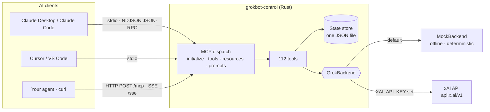

<div align="center">

# GrokBot Control MCP

**Let any AI manage your GrokBot.**

A Rust [Model Context Protocol](https://modelcontextprotocol.io) server that gives
Claude, Cursor, and any other MCP-capable AI complete control over a
[Grok](https://x.ai) (xAI) powered bot — its identity, brain, conversations,
personas, memory, knowledge, schedule, safety, and telemetry.

[](https://www.rust-lang.org)
[](https://modelcontextprotocol.io)
[](#tools-112)
[](#development)
[](LICENSE)

[Quickstart](#quickstart) · [Connect your AI](#connect-your-ai) · [Tools](#tools-112) ·
[Resources](#resources-6) · [Configuration](#configuration) · [Architecture](#architecture)

</div>

---

## Why?

You run a Grok-powered bot. Other AI agents need to *operate* it: retune its
personality, start and steer conversations, teach it facts, schedule briefings,
check its health, and back it up — without a human in the loop and without
glue code for every client.

`grokbot-control` is that control plane. One Rust binary. Three transports
(**stdio** for local clients, **Streamable HTTP** and **legacy SSE** for
remote and older clients). **78 tools, 6
resources, 3 prompts.** Works fully offline with a deterministic mock backend,
and goes live against the real xAI API the moment you set `XAI_API_KEY`.

## Three ways to use it

One engine, one state file, three front doors. They are fully equivalent —
anything one can do, the others can do, and they never disagree.

| Way | For | How |
|---|---|---|
| **MCP server** | AI clients (Claude, Cursor, agents) | `--transport stdio\|http\|sse\|all` — see [Connect your AI](#connect-your-ai) |
| **CLI** | Humans, scripts, cron, CI | `run <tool> --args…`, `chat`, `status`, `repl` — see [CLI mode](#cli-mode) |
| **Skill** | AI agents with a shell but no MCP connection | [`.agents/skills/grokbot-control/`](.agents/skills/grokbot-control/SKILL.md) teaches the agent the CLI/MCP playbook |

## CLI mode

No MCP client needed. Every one of the 78 tools is a shell command;
arguments are validated and coerced (numbers, booleans, lists, JSON) from
each tool's own MCP schema, so the CLI can never drift from the server:

```bash
grokbot-control tools --plain                  # all 78 tool names
grokbot-control run chat --prompt "hello" --temperature 0.2
grokbot-control run conversation-create --title "Release help"
grokbot-control run conversation_send --id <id> --content "hi"
grokbot-control run memory_store --key owner --value Andy --tags person,admin
grokbot-control run memory_recall --args '{"key":"owner"}' --compact
grokbot-control chat tell me a joke            # shortcut: one-shot chat
grokbot-control status                         # shortcut: diagnostics
grokbot-control repl                           # interactive shell
```

Output is JSON on stdout (pretty, or one line with `--compact`). Failures
print `{"ok": false, "error": …, "usage": …}` and exit `1` — script-friendly
and self-correcting for agents. Global flags (`--state-file`, `--backend`,
`XAI_API_KEY`) work exactly as in server mode and go before the subcommand.

### Skill mode

The bundled skill at
[`.agents/skills/grokbot-control/SKILL.md`](.agents/skills/grokbot-control/SKILL.md)
(validated with `muse skills validate`) teaches any skill-capable agent
the operating playbook: prefer MCP tools when connected, fall back to the
CLI otherwise, orient with `diagnostics` first, and respect the safety
guardrails. Copy that directory into any project's `.agents/skills/` (or
your personal skills root) and agents there can run GrokBot immediately.

## Highlights

| | |
|---|---|
| **Complete bot control** | Profile, model, sampling, system prompt, active persona, chat-time tools, safety filters |
| **Real conversations** | Persistent multi-turn threads with fork, summarise, and markdown/JSON export |
| **Personas & templates** | Named personalities with per-persona model/temperature; `{{variable}}` prompt templates |
| **Memory & knowledge** | Key/value long-term memory plus a searchable local document base |
| **Scheduled tasks** | Cron-labelled prompt jobs any agent can create and run on demand |
| **Observable by default** | Token usage by model/tool, request log, one-call `diagnostics` health report |
| **Backup built in** | Full state export/import/reset — the whole bot is one JSON file |
| **Zero-key start** | Mock backend answers deterministically offline; no account needed to develop |
| **Safe HTTP** | Optional Bearer-token auth on the HTTP transport; stdio needs no auth at all |

## Architecture



State is a single pretty-printed JSON file, written atomically (temp file +
rename) after every mutation. Back it up by copying one file, or live via the
`state_export` tool.

## Quickstart

```bash
# 1. Build (stable Rust 1.75+)
cargo build --release

# 2a. Serve over stdio (for local MCP clients) — mock backend, no key needed
./target/release/grokbot-control

# 2b. …or serve over HTTP (Streamable HTTP) for remote agents
./target/release/grokbot-control --transport http --http-addr 127.0.0.1:8080 \
    --auth-token my-secret

# 2c. …or legacy SSE for older MCP clients (GET /sse + POST /messages)
./target/release/grokbot-control --transport sse --http-addr 127.0.0.1:8080

# 2d. …or everything at once: stdio is separate, http+sse share one port
./target/release/grokbot-control --transport all --http-addr 127.0.0.1:8080

# 3. Go live against real Grok (optional)
XAI_API_KEY=xai-... ./target/release/grokbot-control
```

Handy non-serving commands:

```bash
./target/release/grokbot-control tools    # print all 78 tool schemas as JSON
./target/release/grokbot-control doctor   # backend + state health as JSON
./target/release/grokbot-control --help   # every flag, with env equivalents
```

**Talk to it by hand** (stdio, mock backend):

```bash
printf '%s\n' \
  '{"jsonrpc":"2.0","id":1,"method":"initialize","params":{"protocolVersion":"2024-11-05"}}' \
  '{"jsonrpc":"2.0","method":"notifications/initialized"}' \
  '{"jsonrpc":"2.0","id":2,"method":"tools/call","params":{"name":"chat","arguments":{"prompt":"Hello GrokBot"}}}' \
  | ./target/release/grokbot-control
```

## Backends: mock vs live

| | Mock (default) | Live xAI |
|---|---|---|
| When | No `XAI_API_KEY`, or `GROKBOT_BACKEND=mock` | `XAI_API_KEY` set (`auto`), or `GROKBOT_BACKEND=live` |
| Network | None — fully offline | `https://api.x.ai/v1` (override with `XAI_BASE_URL`) |
| Replies | Deterministic echo of your prompt + context, labelled `[mock grok · …]` | Real Grok completions with real token usage |
| Models | Known catalogue (`grok-4`, `grok-3`, `grok-code-fast-1`, …) | Live `GET /models` from xAI |
| Cost | Free | Your xAI usage |

```bash
# Force a mode explicitly
grokbot-control --backend mock    # never touch the network
grokbot-control --backend live    # fail fast if XAI_API_KEY is missing
```

## Login & OAuth

Two login systems, for two different jobs:

### 1. Log in to Grok (backend credential)

```bash
grokbot-control login                 # browser OAuth (PKCE, localhost callback)
grokbot-control login --device        # headless device-code flow
grokbot-control whoami                # issuer, expiry, credential in effect
grokbot-control logout
```

Endpoints come from the issuer's discovery document
(`GROK_OAUTH_ISSUER`, default `https://accounts.x.ai`; override endpoints
with `GROK_OAUTH_AUTHORIZE_URL` / `GROK_OAUTH_TOKEN_URL` / `GROK_OAUTH_DEVICE_URL`,
client id with `GROK_OAUTH_CLIENT_ID`). Tokens land in
`~/.config/grokbot-control/auth.json` (`0600`, dir `0700`) — never in bot
state, never printed, auto-refreshed when a refresh token exists.

Credential precedence: `--credential oauth|api_key` (or `GROKBOT_CREDENTIAL`)
wins; otherwise OAuth login, then `XAI_API_KEY`, then mock. One honest
caveat: **api.x.ai officially documents API keys.** If xAI rejects an OAuth
token, calls fail with a 401 message that says exactly that and points at
the fix — run `grokbot-control run bot_test_connection` to check a login.

### 2. OAuth for MCP clients (server login)

```bash
grokbot-control --transport all --oauth --auth-token approver-secret
```

Exposes discovery (`/.well-known/oauth-protected-resource`,
`/.well-known/oauth-authorization-server`), dynamic client registration
(`/oauth/register`), a consent page (`/oauth/authorize` — the operator
approves with the server token), and `/oauth/token` (authorization-code +
PKCE S256, refresh rotation, codes single-use, 1h access tokens). Scopes:
`read` (reads), `chat` (chat + writes), `admin` (destructive admin tools).
Static `--auth-token` still works and grants all scopes. The server refuses
non-loopback binds with no token and no OAuth.

## Connect your AI

### Claude Desktop / Claude Code (stdio)

```json
{
  "mcpServers": {
    "grokbot": {
      "command": "/absolute/path/to/grokbot-control",
      "args": ["--state-file", "/absolute/path/to/grokbot-state.json"],
      "env": { "XAI_API_KEY": "xai-..." }
    }
  }
}
```

Omit `XAI_API_KEY` to run against the offline mock. Ready-made copies of this
config (Claude, Cursor, VS Code, HTTP) live in [`examples/`](examples/).

### Cursor / VS Code (stdio)

Same shape as above — both accept the standard `mcpServers` stdio config.
See [`examples/cursor.json`](examples/cursor.json) and
[`examples/vscode.json`](examples/vscode.json).

### Any agent over HTTP

```bash
grokbot-control --transport http --http-addr 0.0.0.0:8080 --auth-token my-secret
```

```bash
curl -s http://localhost:8080/health
curl -s -X POST http://localhost:8080/mcp \
  -H 'content-type: application/json' \
  -H 'authorization: Bearer my-secret' \
  -d '{"jsonrpc":"2.0","id":1,"method":"tools/call",
       "params":{"name":"chat","arguments":{"prompt":"Hello GrokBot"}}}'
```

Endpoints (mode `http`): `POST /mcp` (JSON-RPC; send
`Accept: text/event-stream` to get the reply as an SSE `message` event
instead of JSON), `GET /mcp` (standalone server→client SSE stream, returns
an `Mcp-Session-Id`), `DELETE /mcp` (close that stream session),
`GET /health`, `GET /` (server info).

#### Legacy SSE clients (`--transport sse` or `all`)

```bash
curl -N http://localhost:8080/sse -H 'authorization: Bearer <your-token>'
# → event: endpoint
# → data: /messages?sessionId=<uuid>      ← POST your JSON-RPC here
# → event: message                        ← replies stream back here
# → data: {"jsonrpc":"2.0","id":1,"result":{...}}
```

`POST /messages?sessionId=<uuid>` returns `202`; the response is delivered
over the matching SSE stream (`404` for unknown sessions). Keepalive
comments (`: ping`) flow every 15s on both SSE flavours. A runnable version
of this flow is [`examples/sse-client.sh`](examples/sse-client.sh).

Requests without a valid Bearer <your-token> get `401` when Requests without a valid Bearer token get `401` when
`--auth-token` / `MCP_AUTH_TOKEN` is set.

### A typical agent session

> **Agent:** `diagnostics` → backend is `mock`, 3 personas, 0 conversations.
> **Agent:** `persona_activate` `{id: "Coder"}` → GrokBot now codes by default.
> **Agent:** `conversation_create` `{title: "Release help"}` → thread id.
> **Agent:** `conversation_send` → multi-turn help, history kept server-side.
> **Agent:** `conversation_summarize` → summary stored back into the thread.
> **Agent:** `memory_store` `{key: "release-date", value: "2026-12-01"}` → remembered.
> **Agent:** `usage_stats` → token spend by model and tool, any time.

## Tools (112)

Every tool returns JSON as MCP text content (plus `structuredContent` for
object payloads); failures return `isError: true` with the reason. IDs are
UUIDs, but personas, templates, and bots also accept names. Tools are
scope-gated when OAuth is on: reads need `read`, chat/writes need `chat`,
destructive admin needs `admin`.

#### Bot identity, models, provider & safety

| Tool | What it does | Required args |
|---|---|---|
| `bot_get_profile` | Get GrokBot's full profile: name, description, system prompt, default model, sampling, active persona, enabled bot-tools, safety settings. | — |
| `bot_update_config` | Update any subset of GrokBot config: name, description, system_prompt, default_model (validated), temperature (0-2), top_p, max_tokens, daily_budget_usd, rate_limit_per_minute, max_history_messages. | — |
| `bot_list_models` | List Grok models available to GrokBot (live from xAI when connected, otherwise the known catalogue). | — |
| `bot_get_model` | Get details for one Grok model: description, context window, approximate pricing, whether it is live. | `model` |
| `bot_set_default_model` | Set GrokBot's default model (validated against the available model list). | `model` |
| `bot_provider_status` | Show backend status: mock vs live xAI, base URL mode, whether XAI_API_KEY is set, state file path. | — |
| `bot_test_connection` | Send a tiny ping chat to the configured backend and report latency/model. Proves the Grok path works. | — |
| `bot_tools_list` | List GrokBot chat-time tools (web_search, code_execution, ...) and which are enabled. | — |
| `bot_tool_set_enabled` | Enable or disable one of GrokBot's chat-time tools. | `tool`, `enabled` |
| `bot_tool_define` | Define a function tool GrokBot itself may call (sent to xAI as a function tool on chat). Upserts by name. | `name`, `parameters` |
| `bot_tool_defs_list` | List operator-defined GrokBot function tools. | — |
| `bot_tool_delete` | Delete an operator-defined GrokBot function tool by name. | `name` |
| `bot_safety_get` | Get GrokBot safety settings: filter level, blocked topics, max response chars. | — |
| `bot_safety_update` | Update safety settings: filter_level (off\|standard\|strict), blocked_topics, max_response_chars. | — |

#### Bots registry, status & routines

| Tool | What it does | Required args |
|---|---|---|
| `list_bots` | List named bot profiles in the registry, marking the active one. Each bot is a full config profile; activate_bot swaps it in. | — |
| `create_bot` | Create a named bot profile in the registry (clones current config unless fields override). Does not switch to it unless activate=true. | `name` |
| `update_bot` | Update a bot profile's name/description/config fields (by ID or name). | `id` |
| `delete_bot` | Delete a bot profile from the registry (by ID or name). Requires confirm matching the bot name. | `id`, `confirm` |
| `activate_bot` | Switch the live bot to a registry profile (current config is saved back to the previously active profile). | `id` |
| `bot_status` | Bridge-style status: active bot, whether a job is working, unread job results, usage snapshot. | — |
| `routines` | Unified routines tool (like grokbot_routines): action list\|add\|run\|enable\|disable\|remove. add needs name+cron+prompt; run/enable/disable/remove need id. | `action` |
| `task_create` | Create a scheduled task: a prompt + cron expression GrokBot should run (execute via task_run). | `name`, `cron`, `prompt` |
| `task_list` | List scheduled tasks with run counts and last results. | — |
| `task_delete` | Delete a scheduled task by ID. | `id` |
| `task_run` | Run a scheduled task now: sends its prompt to GrokBot and stores the result on the task. | `id` |
| `task_update` | Update a task's name/cron/prompt/persona/enabled (by ID). | `id` |
| `task_set_enabled` | Enable or disable a scheduled task without deleting it. | `id`, `enabled` |

#### Chat, jobs, search & text helpers

| Tool | What it does | Required args |
|---|---|---|
| `chat` | One-shot chat with GrokBot. Uses active/given persona, system prompt, model and sampling from args or bot config. | `prompt` |
| `chat_stream` | Chat using the backend streaming path; returns the assembled reply plus how many deltas arrived (live: token deltas; mock: one delta). | `prompt` |
| `chat_async` | Start a chat in the background and return a job_id immediately. Poll with job_status/job_wait; stop with bot_stop. | `prompt` |
| `job_status` | Get an async job's status/result by job_id. | `id` |
| `job_wait` | Wait up to timeout_seconds for a job to finish and return its result. | `id` |
| `job_list` | List recent async jobs with statuses. | — |
| `bot_stop` | Stop a running async job (by job_id, or the latest running job). Cooperative cancellation for in-flight chats/tasks. | — |
| `chat_batch` | Run several one-shot prompts in sequence and return every reply. Optional shared persona_id/model. | `prompts` |
| `model_compare` | Send the same prompt to several models and compare replies, tokens, and estimated cost side by side. | `prompt`, `models` |
| `web_search` | Search the web with Grok (live backends send a web_search tool to xAI; mock searches local documents instead and says so). | `query` |
| `x_search` | Search X/Twitter with Grok (live backends send an x_search tool to xAI; mock says no live results). | `query` |
| `text_summarize` | Summarise arbitrary text with GrokBot (stateless helper; max_words guides length). | `text` |
| `text_translate` | Translate text into a target language with GrokBot (stateless helper). | `text`, `target_language` |

#### Conversations

| Tool | What it does | Required args |
|---|---|---|
| `conversation_create` | Create a persistent multi-turn conversation (optionally bound to a persona). | — |
| `conversation_list` | List conversations with message counts and last update (no full history). | — |
| `conversation_get` | Get one conversation with full message history by ID. | `id` |
| `conversation_send` | Append a user message to a conversation and get GrokBot's reply (full history is sent as context). | `id`, `content` |
| `conversation_add_message` | Append a raw message (any role) to a conversation without generating a reply. | `id`, `role`, `content` |
| `conversation_fork` | Fork a conversation into a new one, optionally keeping only the first N messages. | `id` |
| `conversation_summarize` | Summarise a conversation with GrokBot and store the summary as an assistant message (store=false to skip). | `id` |
| `conversation_export` | Export a conversation as markdown or json. | `id` |
| `conversation_delete` | Delete a conversation permanently by ID. | `id` |
| `conversation_rename` | Rename a conversation. | `id`, `title` |
| `conversation_set_flags` | Set pinned and/or archived flags on a conversation. | `id` |
| `conversation_search` | Search conversation titles and message contents. | `query` |
| `conversation_clear` | Delete all messages from a conversation but keep the thread itself. | `id` |
| `conversation_stats` | Message/token statistics: globally, or for one conversation with id. | — |
| `conversation_message_edit` | Edit one message in a conversation by message_id (ids are returned by conversation_get). | `id`, `message_id`, `content` |
| `conversation_message_delete` | Delete one message from a conversation by message_id. | `id`, `message_id` |

#### Personas & prompt templates

| Tool | What it does | Required args |
|---|---|---|
| `persona_list` | List all personas (id, name, description, model/temperature overrides). | — |
| `persona_create` | Create a persona: named system prompt + optional model/temperature overrides. | `name`, `system_prompt` |
| `persona_update` | Update fields of an existing persona (by ID or name). | `id` |
| `persona_delete` | Delete a persona (by ID or name). Clears it as active persona if needed. | `id` |
| `persona_activate` | Make a persona GrokBot's active default persona (by ID or name). | `id` |
| `persona_duplicate` | Duplicate a persona under a new name (by ID or name). | `id` |
| `persona_export` | Export personas as portable JSON (one by id/name, or all). | — |
| `persona_import` | Import personas from persona_export JSON (array, or {personas: [...]}). New IDs are assigned. | `personas` |
| `persona_prompt_history` | List a persona's system-prompt version history (by ID or name). | `id` |
| `persona_rollback` | Roll a persona back to a previous prompt version (appends a new version; history is never rewritten). | `id`, `version` |
| `persona_ab_test` | A/B test: send one prompt to two personas (by ID or name) and compare replies/tokens/cost. | `prompt`, `persona_a`, `persona_b` |
| `template_list` | List prompt templates with their {{variables}}. | — |
| `template_create` | Create a prompt template using {{variable}} placeholders. | `name`, `template` |
| `template_update` | Update a template's name/description/body (by ID or name). | `id` |
| `template_delete` | Delete a prompt template (by ID or name). | `id` |
| `template_duplicate` | Duplicate a prompt template under a new name (by ID or name). | `id` |
| `template_render` | Render a template with variables; optionally send the rendered prompt to GrokBot (send=true). | `id` |

#### Memory, knowledge, files & semantic search

| Tool | What it does | Required args |
|---|---|---|
| `memory_store` | Store a long-term memory entry under a key (upserts by key), with optional tags. | `key`, `value` |
| `memory_recall` | Recall memory by exact key, or search keys/values/tags with query. | — |
| `memory_list` | List all memory entries (optionally filter by tag). | — |
| `memory_delete` | Delete a memory entry by ID or key. | `id` |
| `memory_export` | Export all memory entries as portable JSON. | — |
| `memory_clear` | Delete memory entries — all of them, or only one tag (tag arg). Requires confirm=true. | `confirm` |
| `memory_stats` | Memory statistics: entry count, distinct tags, tag counts. | — |
| `document_add` | Add a document to GrokBot's local knowledge base. | `title`, `content` |
| `document_list` | List knowledge-base documents (titles/tags, no full content). | — |
| `document_get` | Get one document with full content by ID. | `id` |
| `document_search` | Full-text search over document titles/content/tags. | `query` |
| `document_update` | Update a document's title/content/tags by ID. | `id` |
| `document_delete` | Delete a knowledge-base document by ID. | `id` |
| `file_upload` | Upload a file to xAI Files (content as base64) or register it locally in mock mode. Optionally also store as a document. | `filename`, `content_base64` |
| `file_list` | List files on the backend (xAI Files live; mock lists locally registered uploads from documents). | — |
| `file_delete` | Delete a file by backend file ID. | `id` |
| `embed_text` | Get embedding vectors for one or more texts (mock: deterministic local vectors; live: xAI embeddings). | `texts` |
| `semantic_search` | Semantic (embedding cosine) search over documents and memories. Embeddings are computed and cached on first use. | `query` |

#### Media

| Tool | What it does | Required args |
|---|---|---|
| `image_generate` | Generate image(s) with Grok image models (mock returns mock:// URLs offline; live uses xAI images API). | `prompt` |
| `image_understand` | Ask GrokBot about an image URL (vision). Mock describes intent offline; live sends the image to a vision model. | `prompt`, `image_url` |
| `video_generate` | Generate a video with Grok imagine-video models (mock returns a mock:// URL offline). | `prompt` |
| `audio_transcribe` | Transcribe base64 audio (live: xAI audio API; mock returns a labelled mock transcript). | `audio_base64` |
| `audio_speak` | Synthesise speech from text; returns base64 audio (mock returns a short silent WAV placeholder). | `text` |

#### Usage, observability & admin

| Tool | What it does | Required args |
|---|---|---|
| `token_count` | Estimate token count for a text (or an array of {role, content} messages). Same estimator the mock backend uses. | — |
| `usage_stats` | Token/request usage totals, broken down by model and by MCP tool. | — |
| `usage_cost` | Estimated USD cost from recorded usage, using approximate per-model pricing. Estimates only. | — |
| `usage_quota` | Budget/quota status: daily budget cap, rate limit, estimated spend today, per-model spend. | — |
| `usage_reset` | Reset usage counters to zero. Requires confirm=true. | `confirm` |
| `request_log` | Recent request log (newest last). limit defaults to 50. | — |
| `request_log_clear` | Clear the request log. Requires confirm=true. | `confirm` |
| `diagnostics` | Full health report: backend, state counts, config summary, uptime-ish checks. Start here when something seems wrong. | — |
| `server_info` | This MCP server's info: name, version, transports, protocol versions, tool/resource/prompt counts, backend, uptime seconds. | — |
| `state_export` | Export the entire GrokBot state (config, personas, conversations, templates, memory, docs, tasks, usage) as JSON. | — |
| `state_import` | Replace GrokBot state from a previous state_export JSON object. Destructive — export first. | `state` |
| `state_backup` | Snapshot current state: returns it as JSON and, when a state file is configured, also writes a timestamped backup file beside it. | — |
| `list_backups` | List timestamped state backups available for restore. | — |
| `state_restore` | Restore state from a backup file name (from list_backups). Auto-backs-up current state first. Requires confirm=true. | `backup`, `confirm` |
| `state_validate` | Validate state integrity: duplicate IDs, dangling active persona / conversation personas, counts. Returns problems found (empty = healthy). | — |
| `state_reset` | Reset GrokBot to factory defaults (keeps nothing). Requires confirm=true. | `confirm` |

> Generated from the server's own `tools/list` output — run
> `grokbot-control tools` for the authoritative list.

**Seeded on first run:** personas `Assistant`, `Coder`, `Researcher` and
templates `explain`, `code-review`.

## Resources (6)

Read-only views any client can fetch without a tool call:

| URI | Contents |
|---|---|
| `grokbot://config` | Current bot configuration |
| `grokbot://personas` | All personas |
| `grokbot://conversations` | Conversation summaries |
| `grokbot://models` | Available Grok models |
| `grokbot://usage` | Token/request usage |
| `grokbot://log` | Recent request log |

## Prompts (3)

| Prompt | Arguments | Purpose |
|---|---|---|
| `chat_with_persona` | `persona`, `prompt` | Chat as a named persona |
| `summarize_conversation` | `conversation_id` | Summarise a stored thread |
| `code_review` | `code`, `language?` | Review code as the Coder persona |

## Configuration

CLI flags win, then environment, then defaults. Every flag has an env twin.

| Flag | Env | Default | Meaning |
|---|---|---|---|
| `--transport` | `GROKBOT_TRANSPORT` | `stdio` | `stdio` · `http` (Streamable) · `sse` (legacy) · `all` |
| `--http-addr` | `GROKBOT_HTTP_ADDR` | `127.0.0.1:8080` | Web listen address (http/sse/all) |
| `--state-file` | `GROKBOT_STATE_FILE` | `~/.local/share/grokbot-control/state.json` | State JSON path |
| `--backend` | `GROKBOT_BACKEND` | `auto` | `auto` · `mock` · `live` |
| `--credential` | `GROKBOT_CREDENTIAL` | `auto` | `auto` · `oauth` · `api_key` |
| `--profile` | `GROKBOT_PROFILE` | *(none)* | Named state profile under `~/.local/share/grokbot-control/profiles/<name>/` |
| `--oauth` | `MCP_OAUTH_ENABLED` | off | Built-in OAuth 2.1 server for MCP clients |
| `--auth-token` | `MCP_AUTH_TOKEN` | *(none)* | Bearer token for HTTP `/mcp` |
| — | `XAI_API_KEY` | *(unset)* | xAI key; setting it flips `auto` to live |
| — | `XAI_BASE_URL` | `https://api.x.ai/v1` | xAI-compatible API base |
| — | `RUST_LOG` | *(unset)* | Tracing filter, e.g. `RUST_LOG=debug` (stderr only) |

Subcommands: `serve` (default), `tools` (dump tool schemas), `doctor`
(diagnostics JSON without serving).

## Protocol notes

- JSON-RPC 2.0. Stdio is newline-delimited. Streamable HTTP accepts a
  single request or a batch array and replies with plain JSON, or with an
  SSE `message` event when the client sends `Accept: text/event-stream`
  (`202` for notifications). Legacy SSE (2024-11-05 transport) pairs
  `GET /sse` with `POST /messages?sessionId=…`.
- Negotiates `2024-11-05`, `2025-03-26`, and `2025-06-18`; unknown client
  versions fall back to `2024-11-05`.
- Methods: `initialize`, `ping`, `tools/list`, `tools/call`,
  `resources/list`, `resources/templates/list`, `resources/read`,
  `prompts/list`, `prompts/get`. Notifications are accepted silently.
- Errors: `-32700` parse, `-32601` unknown method, `-32602` bad
  resource/prompt, `-32603` internal, `-32001` unauthorized (HTTP).
  Tool-level failures (missing conversation, blocked topic, …) come back as
  results with `isError: true` so agents can read and recover from them.
- Stdout carries protocol only — all logs go to stderr.

## Safety & security

- **Blocked topics:** `bot_safety_update` with `blocked_topics` makes `chat`
  and `conversation_send` refuse matching prompts (case-insensitive).
- **HTTP auth:** set `--auth-token` before binding beyond localhost. Stdio
  inherits the client's process trust, as with every stdio MCP server.
- **Destructive tools are explicit:** `state_import` replaces everything,
  `state_reset` needs `confirm: true`. `state_export` first — always.
- **Bind guard:** non-loopback binds refuse to start without a token or OAuth.
- **Single writer:** an OS file lock stops two processes sharing one state file.
- **Crash safety:** every save is fsynced via a unique temp file; a corrupt
  state file is quarantined and the newest backup restored automatically.
- **Scopes:** with OAuth on, destructive tools (`state_import`, `state_reset`,
  `state_restore`, `usage_reset`, …) need the `admin` scope.
- **Keys stay out of state:** `XAI_API_KEY` is read from the environment only
  and never written to the state file or returned by any tool
  (`bot_provider_status` reports only whether it is set).

## Development

```bash
cargo test            # 23 tests: unit + CLI + MCP/OAuth transports + stub-xAI + state recovery
cargo clippy --all-targets
cargo build --release
```

```
src/
  main.rs     CLI (serve / tools / doctor), transport selection
  lib.rs      crate root, protocol constants
  mcp.rs      JSON-RPC dispatch: initialize, tools, resources, prompts
  tools.rs    all 78 tool handlers + resources + prompts
  cli.rs      CLI front-end: run <tool>, repl, shortcuts (schema-driven)
  state.rs    BotConfig/Persona/Conversation/… + JSON store (atomic saves)
  backend.rs  GrokBackend trait · MockBackend · XaiBackend (reqwest)
  server.rs   stdio + Streamable HTTP /mcp + legacy SSE /sse,/messages
tests/
  integration.rs   drives the real dispatch end-to-end for every tool group
examples/          copy-paste client configs (Claude, Cursor, VS Code, HTTP, SSE)
.agents/skills/    grokbot-control skill (CLI/MCP playbook for agents)
docs/plans/        the implementation plan this project was built from
```

The integration suite calls every tool's happy path plus safety/error paths
through the actual MCP layer — no network, no key, milliseconds to run.

## Roadmap

Done in this release: three transports (stdio/HTTP/SSE), CLI + skill,
OAuth login (Grok account + built-in MCP OAuth with scopes), rename to
`grokbot-control` with state migration, cron routines that actually fire,
multi-bot registry, async jobs, streaming, files/embeddings/semantic
search, structured output, audio/video, persona versioning, backup
restore/rotation, per-model cost accounting.

Still open:
- [ ] Token-level streaming over MCP progress notifications
- [ ] xAI Collections API (local collection grouping ships; live
      Collections endpoints unverified without a key)
- [ ] Signed webhooks and list_changed broadcasts to SSE subscribers
- [ ] Homebrew formula / systemd + launchd units

## Inspiration & credits

Patterns adopted (no code copied) from the GrokBot ecosystem:

- [TheSethRose/grokbot-bridge](https://github.com/TheSethRose/grokbot-bridge) —
  the unified `routines` action tool, bot registry (`list_bots`/`create_bot`/…),
  and ask → wait → stop job control (`chat_async`, `job_wait`, `bot_stop`, `bot_status`).
- [Kenzim/grokbot-mcp](https://github.com/Kenzim/grokbot-mcp) — PKCE browser
  login shape and 0600 credential storage discipline.
- [merterbak/Grok-MCP](https://github.com/merterbak/Grok-MCP) — video generation,
  first-class web/X search tools, and file support on the inference side.
- [rthomas24/grok-bot-mcp](https://github.com/rthomas24/grok-bot-mcp) — shipping
  an MCP server and an agent skill as one package (mirrored by our CLI + skill).
- [robzilla1738/grokbot-gateway](https://github.com/robzilla1738/grokbot-gateway)
  and [muhrifqie/Grok2API](https://github.com/muhrifqie/Grok2API) — gateway/ops
  patterns (usage visibility, account status) reflected in `usage_quota`/`bot_status`.

Those projects drive the Grok Bot desktop/cloud app; this one manages a
GrokBot over the xAI API from any MCP client, CLI, or skill.

## License

MIT — see [LICENSE](LICENSE).


